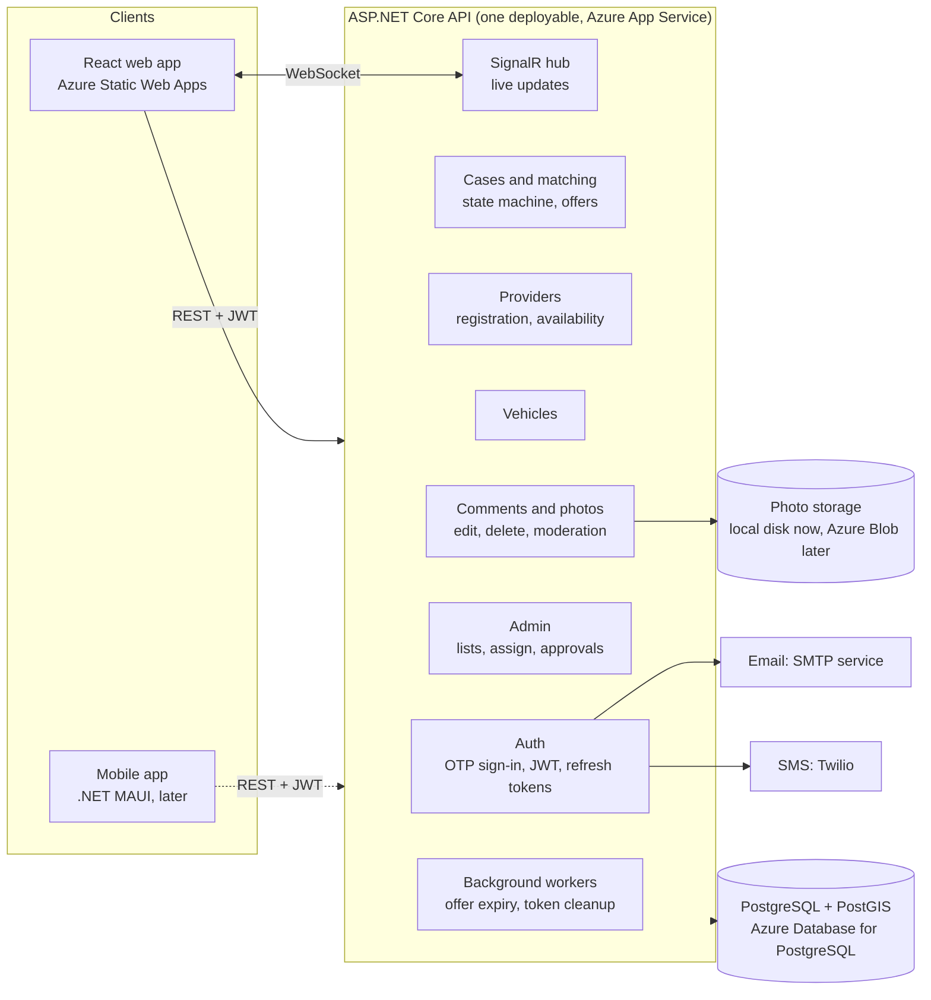
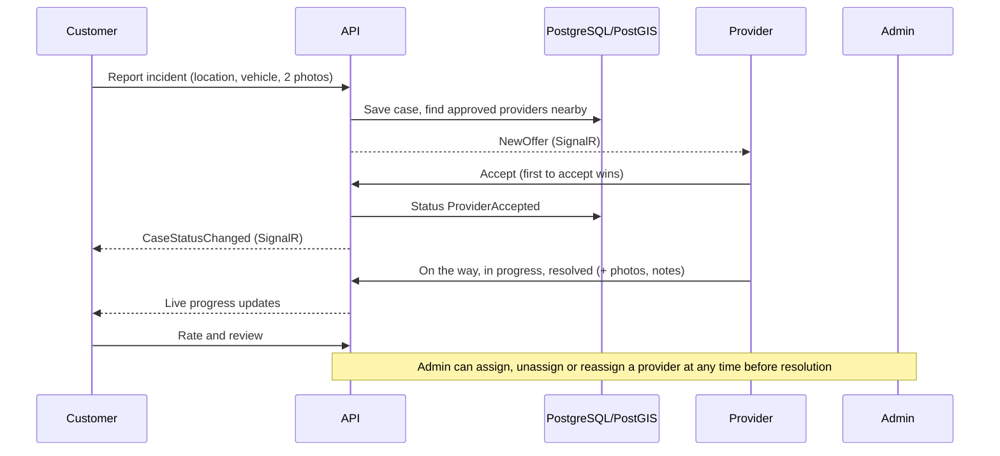

# DriveShield architecture

**Style:** modular monolith. One ASP.NET Core API, one PostgreSQL + PostGIS database, one React web app.
The code is split into clear modules so that any of them can later become its own service.

## System view

## How a request flows

## Modules

| Module | Code | Responsibility |
|---|---|---|
| Auth | `Auth/`, `Endpoints/AuthEndpoints.cs` | Email/mobile one-time codes, JWT access tokens (15 min), rotating refresh tokens (30 days), admin rights from `Auth:AdminEmails` |
| Cases and matching | `Application/CaseWorkflowService.cs`, `CaseStateMachine.cs`, `Endpoints/CaseEndpoints.cs` | Case lifecycle, nearest-provider matching (PostGIS), offers and expiry |
| Providers | `Endpoints/ProviderEndpoints.cs` | Registration, approval status, availability, base location, jobs |
| Vehicles | `Endpoints/VehicleEndpoints.cs` | Customer vehicles (customers only) |
| Comments and photos | `Endpoints/CommentEndpoints.cs`, `Infrastructure/LocalPhotoStore.cs` | Per-step posts and photos, edit and delete, admin removal |
| Admin | `Endpoints/AdminEndpoints.cs`, `AdminDirectoryEndpoints.cs`, `Application/AdminAssignmentService.cs` | Customers, providers, requests, assign / unassign / reassign, photo review |
| Live updates | `Hubs/CaseHub.cs` | SignalR groups per case and per provider |
| Workers | `Application/OfferExpiryWorker.cs`, `AuthCleanupWorker.cs` | Expire unanswered offers, escalate stuck cases, clear old codes and tokens |

## Why a modular monolith

- One deployment and one database keep cost, debugging and transactions simple (a case, its offers and its timeline change together).
- Modules talk through plain method calls today, so splitting later does not mean rewriting them.

## If it needs to split later

1. **Photos and notifications:** photo storage to Azure Blob; email and SMS sending into an Azure Function.
2. **Matching and offer expiry:** a separate worker fed by an Azure Service Bus queue.
3. **Identity:** move sign-in to Microsoft Entra External ID (replaces the JWT code).
4. Only then consider separate databases per service.

## Production notes

- Set `Auth__Jwt__SigningKey`, `Auth__Otp__Delivery=Live`, SMTP / Twilio settings, `Cors__Origins`, `ConnectionStrings__Default`.
- Apply `db/patches/*.sql` once; swap local photo storage for Azure Blob before taking real photos.
- Swagger and `/openapi/v1.json` are Development only.
